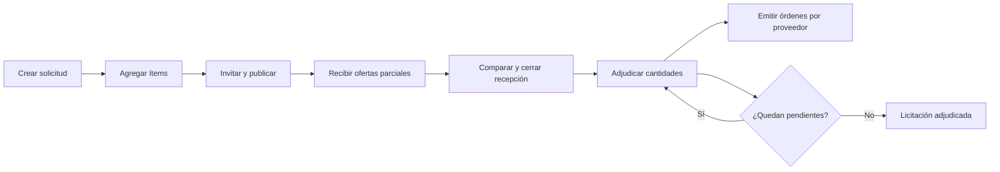

<div align="center">

# Bidflow

### De la solicitud de cotización a la adjudicación, en un mismo flujo.

Plataforma SaaS B2B para gestionar licitaciones, comparar ofertas y distribuir compras entre múltiples proveedores.

**Productos · Servicios · Obras · Cualquier industria**

[](https://www.php.net/)
[](https://laravel.com/)
[](https://www.postgresql.org/)
[](https://redis.io/)
[](https://getbootstrap.com/)
[](https://docs.docker.com/compose/)
[](LICENSE)

[Inicio rápido](#inicio-rápido) · [Funcionalidades](#funcionalidades) · [API y documentación](#api-y-documentación) · [API REST](docs/openapi.yaml)

</div>

---

## ¿Qué es Bidflow?

Bidflow organiza el ciclo de una compra B2B: una organización define qué necesita, invita a proveedores, recibe sus cotizaciones, compara las condiciones y decide cómo adjudicar. Cada proveedor opera desde su propio portal y consulta exclusivamente sus invitaciones, ofertas y resultados.

Una licitación puede cubrir insumos de oficina, desarrollo de software, mantenimiento, transporte o una obra. El motor es genérico e independiente del sistema que origine la solicitud; las referencias externas permiten relacionar datos sin depender de otras bases ni de integraciones obligatorias.

Su capacidad central es la **adjudicación parcial y distribuida**: un mismo ítem puede repartirse entre varios proveedores y completarse en operaciones posteriores, con trazabilidad de cantidades, precios y responsables.

## Funcionalidades

| Espacio | Qué permite hacer |
| --- | --- |
| **Panel comprador** | Administrar licitaciones e ítems, seleccionar proveedores, publicar solicitudes y consultar indicadores reales. |
| **Portal proveedor** | Consultar invitaciones, preparar ofertas parciales, guardar borradores y presentar cotizaciones definitivas. |
| **Comparador de ofertas** | Comparar por ítem los precios, cantidades, plazos y condiciones de cada proveedor. |
| **Adjudicaciones** | Distribuir cantidades entre proveedores, conservar pendientes y registrar el motivo de cada decisión. |
| **Órdenes** | Generar órdenes independientes por proveedor a partir de las cantidades adjudicadas. |
| **API REST** | Operar los flujos mediante endpoints versionados bajo `/api/v1`, con autenticación Sanctum. |
| **Multiempresa** | Trabajar con varias organizaciones y roles, manteniendo separados sus datos y permisos. |

### Una compra, varios proveedores

Para una solicitud de **100 notebooks y 50 monitores**, el comprador puede adjudicar:

| Ítem | Proveedor | Cantidad adjudicada |
| --- | --- | ---: |
| Notebooks | Proveedor A | 60 |
| Notebooks | Proveedor B | 40 |
| Monitores | Proveedor C | 30 |
| Monitores | Pendiente de adjudicación | 20 |

Bidflow conserva los 20 monitores pendientes y permite adjudicarlos después. Cada proveedor recibe únicamente las órdenes correspondientes a sus líneas. Las cantidades acumuladas no pueden superar lo solicitado ni lo ofrecido.

## Cómo funciona



Los borradores son editables. Una oferta presentada conserva su snapshot histórico y una adjudicación confirmada mantiene sus condiciones económicas inmutables. Las operaciones críticas usan transacciones, bloqueos e idempotencia para evitar duplicados y sobre-adjudicaciones ante reintentos o concurrencia.

## Tecnologías

| Capa | Tecnologías |
| --- | --- |
| Backend | PHP 8.4, Laravel 13, Laravel Sanctum |
| Interfaz | Blade, Bootstrap 5.3.8 y JavaScript vanilla |
| Persistencia | PostgreSQL 17, ULID, JSONB y aritmética decimal con BCMath |
| Procesos | Redis 7.4, Predis, Laravel Horizon y Scheduler |
| Entorno local | Docker Compose, nginx y Mailpit |
| Calidad | PHPUnit 12, Laravel Pint y GitHub Actions |
| Contratos | OpenAPI 3.1 y colecciones Postman |

La interfaz sirve sus recursos localmente y no requiere npm, una SPA ni compilación de JavaScript.

## Inicio rápido

Requisitos: **Docker Engine**, **Docker Compose v2** y los puertos **8080** y **8025** disponibles. No hace falta instalar PHP ni Composer en el host.

Desde el directorio del proyecto, para una instalación nueva:

```bash
cp .env.example .env
cp .env.testing.example .env.testing

# En Linux, ajustar LOCAL_UID y LOCAL_GID en .env si corresponde.
docker compose build app
docker compose up -d postgres redis mailpit
docker compose run --rm app composer install --no-interaction
docker compose run --rm app php artisan key:generate
docker compose run --rm app php artisan migrate
docker compose up -d app nginx worker scheduler
```

### Probar con datos demo

```bash
docker compose exec app php artisan bidding:seed-phase3-demo
```

El comando solicita una contraseña local de al menos 12 caracteres y agrega una organización ficticia con licitaciones, ofertas, adjudicaciones parciales y completas, y órdenes por proveedor.

| Acceso | Cuenta demo |
| --- | --- |
| Comprador | `comprador.fase3@example.test` |
| Proveedores | `portal1@example.test`, `portal2@example.test`, `portal3@example.test` |

Las cuatro cuentas usan la contraseña elegida al ejecutar el comando. **No existe una contraseña predeterminada.** La demo requiere entorno `local` o `testing` y `BIDDING_DEMO_ENABLED=true`; agrega datos sin sobrescribir los existentes y rechaza repetirse si ya fue cargada.

### Abrir la aplicación

| Servicio | Dirección local |
| --- | --- |
| Panel comprador | http://localhost:8080/login |
| Portal proveedor | http://localhost:8080/portal/login |
| API REST | http://localhost:8080/api/v1 |
| Salud de la API | http://localhost:8080/api/v1/health |
| Mailpit | http://localhost:8025 |

Para recorrer el flujo completo, ingresar como proveedor y presentar una oferta. Luego, como comprador, abrir **Ofertas y adjudicaciones** desde el detalle de la licitación para comparar, cerrar recepción y distribuir cantidades.

### Actualizar una instalación existente

```bash
docker compose exec app php artisan migrate
docker compose exec app php artisan optimize:clear
docker compose restart app worker scheduler
```

Las migraciones conservan los datos existentes y evolucionan el modelo de adjudicaciones. No es necesario borrar volúmenes ni volver a cargar seeders. Los datos y clasificaciones sectoriales de la demo inicial se mantienen por compatibilidad; las nuevas licitaciones usan `products`, `services` y `works`.

## Arquitectura y seguridad

Bidflow es un **monolito modular multiempresa**. La API y las pantallas Blade comparten acciones de dominio, validaciones y reglas de negocio.

- **Aislamiento por organización:** `TenantContext`, `TenantModel`, policies y claves foráneas compuestas. Los IDs enviados por el cliente no conceden autorización.
- **Identidades separadas:** usuarios compradores con membresías y roles; cuentas `SupplierUser` vinculadas explícitamente a un proveedor.
- **Acceso seguro:** sesiones Laravel con CSRF para la web y tokens Sanctum para la API, almacenados como hash y con vencimiento.
- **Economía exacta:** cantidades e importes decimales, sin floats; moneda ARS en el MVP.
- **Integridad transaccional:** control acumulado de cantidades, bloqueos de filas y restricciones PostgreSQL.
- **Trazabilidad:** auditoría, historial de estados y snapshots económicos de ofertas y adjudicaciones.

Los roles `owner`, `admin` y `operator` pueden operar; `viewer` tiene acceso de lectura. El proveedor consulta exclusivamente su información, sin acceso a las cotizaciones de competidores.

## API y documentación

| Documento | Contenido |
| --- | --- |
| [OpenAPI](docs/openapi.yaml) | Endpoints, autenticación, payloads, respuestas y errores. |
| [Postman: licitaciones](docs/postman/Bidflow-phase-2.postman_collection.json) | Creación, ítems, invitaciones y publicación. |
| [Postman: ofertas y adjudicaciones](docs/postman/Bidflow-phase-3.postman_collection.json) | Portal, ofertas, comparación, adjudicación y órdenes. |

## Pruebas y calidad

```bash
docker compose exec app php artisan test
docker compose exec app vendor/bin/pint --test
docker compose exec app composer validate --strict
```

La suite cubre autenticación, autorización, aislamiento multiempresa, flujos web/API, ofertas parciales, snapshots, integridad referencial, adjudicación distribuida, idempotencia, rollback y concurrencia real en PostgreSQL.

**Última validación registrada: 128 tests y 1074 assertions**, con Pint y Composer correctos. También se verificó el flujo en Chromium con sesiones y CSRF reales, en escritorio y móvil. Esa validación utilizó PostgreSQL 14 aislado; Compose y CI están configurados con PostgreSQL 17.

Las pruebas exigen una base dedicada cuyo nombre termine en `_testing`. La configuración de inicio crea `bidflow_testing` al inicializar un volumen nuevo. Si un entorno existente no tiene esa base, crearla con `docker compose exec postgres createdb -U bidflow bidflow_testing`.

## Estado y próximos pasos

El flujo de licitaciones, portal proveedor, ofertas parciales, comparación, adjudicación distribuida y órdenes está implementado. El proyecto continúa en desarrollo.

Próximas áreas de trabajo:

- Envío de correos y procesamiento del outbox.
- Entrega de webhooks e integraciones.
- Cancelación, expiración automática y revisión/anulación de operaciones.
- Administración avanzada de usuarios y proveedores.
- Evolución de la ejecución de órdenes.

El MVP no incluye pagos, facturación, logística ni selección automática de proveedores. Los eventos se persisten en outbox, sin enviarse a servicios externos.

## Contribuir

Las mejoras, reportes de errores y propuestas son bienvenidos. Los cambios deben respetar el aislamiento por organización, las reglas de cantidades y los contratos de la API descritos en este README y en OpenAPI.

Para proponer un cambio, describir el problema y su solución, agregar pruebas cuando corresponda y ejecutar la suite y Pint. Los ejemplos deben usar datos ficticios; las credenciales y archivos `.env` locales no se versionan.

## Licencia

Distribuido bajo la **licencia MIT**. Consultar [LICENSE](LICENSE) para el texto completo.
